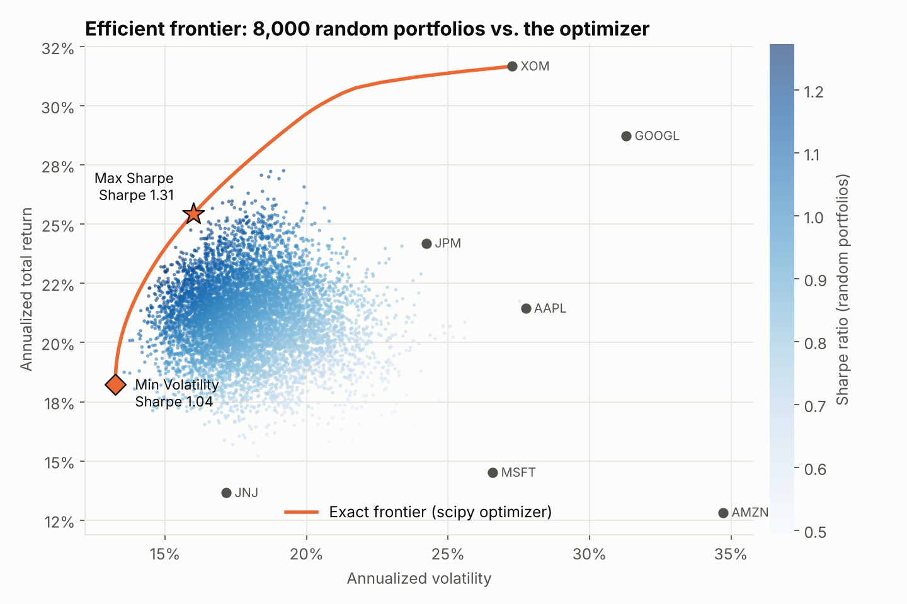
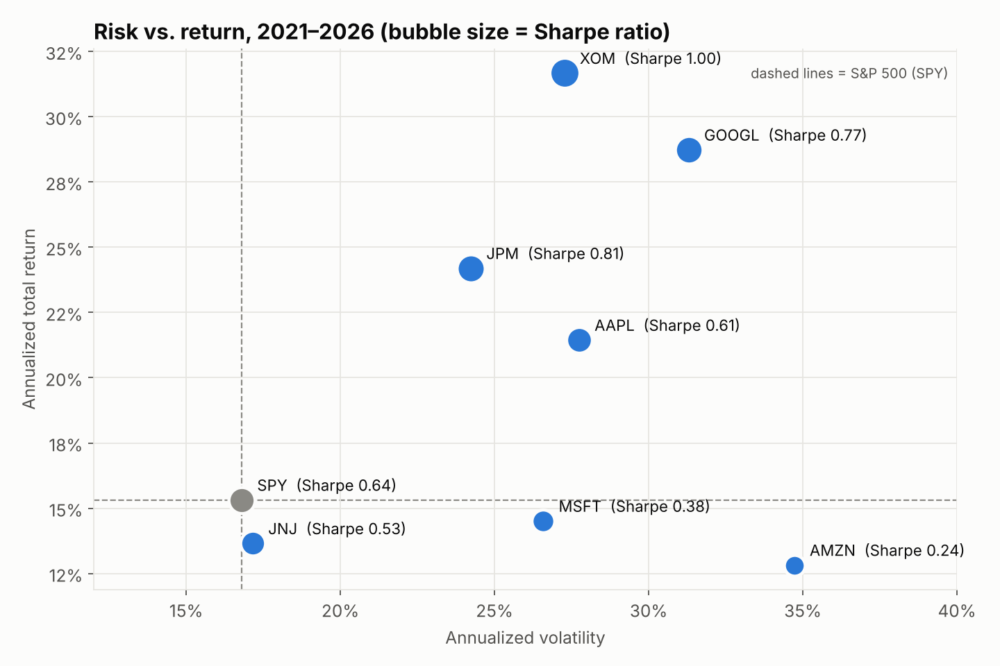
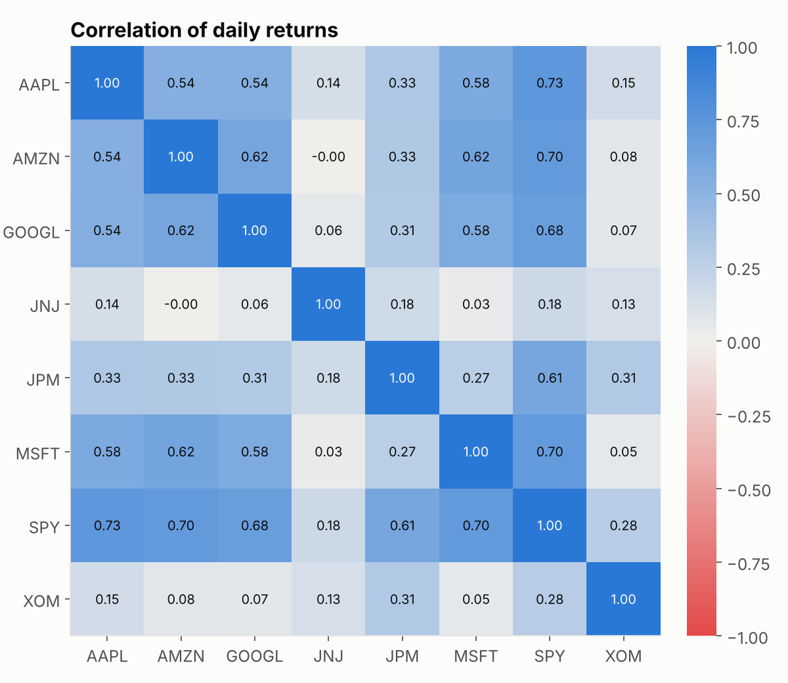
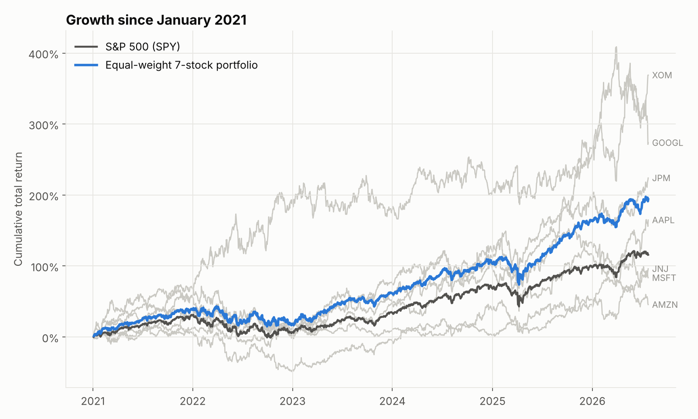

# Stock Portfolio Risk Analysis: SQL → Python → Tableau

An end-to-end analysis of a 7-stock portfolio (AAPL, MSFT, GOOGL, AMZN, JPM, JNJ, XOM) against the S&P 500 (SPY), using **real daily prices from Yahoo Finance, January 2021 to July 2026** (1,395 trading days × 8 tickers).

**Stack:** SQLite (schema + window-function queries) → Python (pandas, NumPy, SciPy) → Tableau dashboards



## Questions

1. **Which stocks were worth their risk?** Not just which had the highest returns, but which had the best return per unit of risk.
2. **Which stocks diversify the portfolio**, and which move in lockstep?
3. **What would an optimized portfolio have looked like**, and how close does a Monte Carlo search get to the true optimum?

## Key findings

| Ticker | Annual return | Volatility | Sharpe | Max drawdown | Beta vs SPY |
|---|---:|---:|---:|---:|---:|
| **XOM** | 31.7% | 27.3% | **1.00** | −20.5% | 0.45 |
| JPM | 24.2% | 24.2% | 0.81 | −38.8% | 0.88 |
| GOOGL | 28.7% | 31.3% | 0.77 | −44.3% | 1.26 |
| *SPY (benchmark)* | *15.3%* | *16.8%* | *0.64* | *−24.5%* | *1.00* |
| AAPL | 21.4% | 27.7% | 0.61 | −33.4% | 1.20 |
| JNJ | 13.7% | 17.2% | 0.53 | −18.4% | 0.19 |
| MSFT | 14.5% | 26.6% | 0.38 | −37.1% | 1.11 |
| AMZN | 12.8% | 34.7% | 0.24 | −56.1% | 1.46 |

*Total returns (dividends included), 252-day annualization, risk-free rate 4.5%.*

- **XOM had the best risk-adjusted return** (Sharpe 1.00). It also has a low beta (0.45) and the smallest drawdown among high-return names.
- **Only 3 of 7 stocks beat the S&P 500 on a risk-adjusted basis:** XOM, JPM and GOOGL. AAPL had a higher raw return than SPY but a lower Sharpe ratio.
- **AMZN was the weakest holding:** the highest volatility, the lowest return, and the deepest drawdown (−56%).
- **JNJ is the portfolio's diversifier:** its correlation with the tech names is about 0.00–0.14, and its beta is 0.19.
- **Diversification beats stock-picking:** the optimized portfolio reached **Sharpe 1.31**, higher than every individual stock, at only 16.0% volatility.
- **The Monte Carlo search got close but not all the way:** the best of 8,000 random portfolios reached Sharpe 1.27, about 97% of the true optimum found by the SciPy optimizer.

| Portfolio | Return | Volatility | Sharpe | Largest weights |
|---|---:|---:|---:|---|
| **Max Sharpe (optimizer)** | 25.4% | 16.0% | **1.31** | XOM 37%, JNJ 24%, GOOGL 23%, JPM 16% |
| Max Sharpe (Monte Carlo) | 24.8% | 15.9% | 1.27 | XOM 30%, GOOGL 23%, JNJ 21% |
| Min Volatility (optimizer) | 18.2% | 13.2% | 1.04 | JNJ 52%, MSFT 16%, XOM 15% |
| Equal weight (1/7 each) | 21.0% | 17.4% | 0.95 | — |

**Full write-up:** [docs/FINDINGS_REPORT.md](docs/FINDINGS_REPORT.md)

<p>


</p>



## Methods

All formulas use daily total returns $r_t = P^{adj}_t / P^{adj}_{t-1} - 1$, computed in SQL with `LAG()`.

| Metric | Formula |
|---|---|
| Annualized return | $\mu = 252 \cdot \bar r$ |
| Annualized volatility | $\sigma = \sqrt{252} \cdot \text{sd}(r)$ |
| Sharpe ratio | $S = (\mu - r_f)/\sigma$, with $r_f = 4.5\%$ |
| Max drawdown | $\min_t \left( P_t / \max_{s \le t} P_s - 1 \right)$ |
| Beta | $\beta_i = \text{Cov}(r_i, r_{SPY}) / \text{Var}(r_{SPY})$ |
| Portfolio return / risk | $R_p = w^\top \mu$, $\sigma_p = \sqrt{w^\top \Sigma w}$ |
| Max-Sharpe portfolio | $\max_w (w^\top\mu - r_f)/\sqrt{w^\top\Sigma w}$ subject to $\sum w_i = 1$, $0 \le w_i \le 1$ |

## Pipeline

```
Yahoo Finance ──► 01_data_ingestion.py ──► SQLite (data/stocks.db)
                                              │  sql/01_schema.sql         tickers + prices tables
                                              │  sql/02_analysis_queries   LAG / AVG OVER / RANK window functions
                                              ▼
                            03_portfolio_analysis.py   risk metrics, correlation, Monte Carlo frontier
                            04_optimize_frontier.py    exact frontier with scipy.optimize (SLSQP)
                            05_make_charts.py          README charts
                                              ▼
                                exports/*.csv ──► Tableau dashboards (docs/TABLEAU_GUIDE.md)
```

## Project structure

```
sql/
  01_schema.sql                 table definitions (tickers, prices) with keys and indexes
  02_analysis_queries.sql       window-function queries: returns, SMAs, rolling stats, best/worst days, sectors
python/
  00_generate_sample_data.py    synthetic data for offline testing only (not used in the results)
  01_data_ingestion.py          real data pull via yfinance -> SQLite
  03_portfolio_analysis.py      SQL -> pandas: metrics, correlation, Monte Carlo frontier, CSV exports
  04_optimize_frontier.py       exact efficient frontier + max-Sharpe / min-vol portfolios (SciPy)
  05_make_charts.py             PNG charts for this README
data/stocks.db                  SQLite database (real prices, Jan 2021 – Jul 2026)
exports/                        Tableau-ready CSVs
docs/
  FINDINGS_REPORT.md            full analysis write-up
  TABLEAU_GUIDE.md              field-by-field dashboard build guide
  figures/                      charts
```

## How to run

```bash
python -m venv .venv && source .venv/bin/activate   # Windows: .venv\Scripts\activate
pip install -r requirements.txt

cd python
python 01_data_ingestion.py      # optional: refresh prices from Yahoo Finance (needs internet; results will change)
python 03_portfolio_analysis.py  # metrics + Monte Carlo frontier -> exports/
python 04_optimize_frontier.py   # exact frontier -> exports/
python 05_make_charts.py         # charts -> docs/figures/
```

To explore the SQL layer, open `data/stocks.db` in DB Browser for SQLite (or `sqlite3 data/stocks.db`) and run the queries in `sql/02_analysis_queries.sql`.

## Tableau dashboards

The CSVs in `exports/` feed five Tableau views: price trends, cumulative returns, the risk/return bubble chart, the correlation heatmap, and the efficient frontier. See [docs/TABLEAU_GUIDE.md](docs/TABLEAU_GUIDE.md) for build steps.

## Assumptions and limitations

- Returns are **total returns** from adjusted close, so dividends and splits are included.
- 252 trading days per year; constant 4.5% risk-free rate.
- Long-only weights, no transaction costs, no rebalancing costs.
- The optimal weights are **in-sample**: they are chosen with hindsight on the same 2021–2026 data, so they describe the past and do not predict future performance.
- Educational analysis, not investment advice.

## Possible extensions

- Out-of-sample test: optimize on 2021–2023, then evaluate on 2024–2026.
- Rolling Sharpe ratio and rolling correlation, to see how diversification changes over time.
- Add more holdings and sectors, or a factor model (market, size, value).
